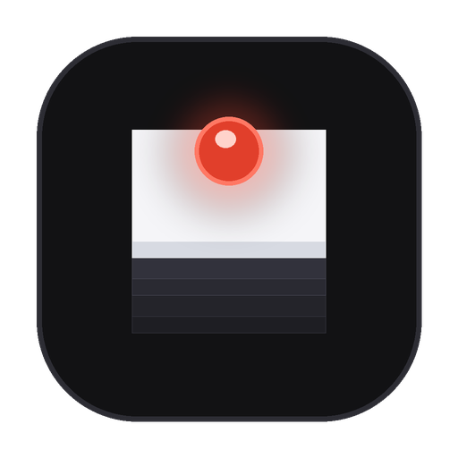

<p align="center">
  
</p>

<h1 align="center">Modula</h1>

<p align="center">
  <strong>Minimalist Canvas LMS module manager, offline downloader, and real-time auto-sync hub.</strong>
</p>

<p align="center">
  <a href="#downloads"></a>
  <a href="#downloads"></a>
  <a href="#license"></a>
</p>

---

## ⚡ Overview

**Modula** is a distraction-free, high-performance desktop application designed for students. Connect your university Canvas LMS account with a single API token to browse, download, and automatically synchronize course modules, lecture slides, assignments, and study materials offline.

Built with a strict Swiss-inspired aesthetic: pure obsidian black, clean white, and the signature Canvas scarlet red.

---

## ✨ Features

- **Personal API Token Connection**: Seamlessly connects to any university Canvas instance (Birmingham, Oxford, Manchester, Canvas Free, or your custom domain).
- **Module Explorer**: View all modules, pages, files, assignments, quizzes, and resources structured exactly as they appear in Canvas.
- **Granular & Batch Downloads**:
  - 📥 **One-Click Course Download**: Download all modules and files across the entire semester with one click.
  - 📁 **Module Download**: Download an entire week's or topic's materials into a numbered, organized folder.
  - 📄 **Single-File Download**: Download specific slides, past papers, or templates manually.
- **Real-Time Auto-Sync & Delta Updates**:
  - Background polling (configurable from 5 min to 1 hr).
  - Detects when professors add new modules or upload updated lecture slides.
  - Displays a vibrant **NEW** badge and sends native desktop notifications.
  - Optional **"Auto-Download New Items"** switch to automatically save newly posted files to your computer.
- **Smart Page & Media Parsing**:
  - Canvas Pages are automatically converted into readable Markdown (`.md`) and standalone HTML.
  - Embedded images and file links referenced inside pages are extracted and saved automatically.
- **Minimalist Aesthetic & Themes**:
  - Pure, distraction-free typography.
  - Instant toggle between **Dark Mode** (system default) and **Light Mode**.
- **Cross-Platform**:
  - Native performance and look on **macOS** (DMG / Apple Silicon & Intel) and **Windows** (Installer & Portable EXE).

---

## 📥 Downloads

Download the latest version for your operating system from [Releases](https://github.com/MananDua28/Canvas-Downloader/releases):

| Operating System | Package | Description |
| :--- | :--- | :--- |
| **macOS** | [`.dmg`](https://github.com/MananDua28/Canvas-Downloader/releases) | Native Apple Disk Image installer |
| **macOS** | [`.zip`](https://github.com/MananDua28/Canvas-Downloader/releases) | Standalone zipped application |
| **Windows** | [`.exe (Installer)`](https://github.com/MananDua28/Canvas-Downloader/releases) | Windows Setup wizard with desktop shortcut |
| **Windows** | [`.exe (Portable)`](https://github.com/MananDua28/Canvas-Downloader/releases) | Zero-install standalone executable |

---

## 🔑 How to Get Your Canvas API Access Token

1. Log in to your university Canvas account (e.g. `https://canvas.bham.ac.uk`).
2. Click your **Account** icon (profile picture) in the top-left sidebar.
3. Select **Settings**.
4. Scroll down to the **Approved Integrations** section.
5. Click **+ New Access Token**.
6. Enter a name (e.g. `Modula`) and click **Generate Token**.
7. Copy the generated token string and paste it into Modula's Settings modal.

---

## 📂 Local Directory Organization

Files downloaded with Modula are structured cleanly by default:

```
~/Downloads/Modula/
└── [Course Code] - [Course Name]/
    ├── 01_ABOUT YOUR MODULE/
    │   ├── Welcome to the Module.md
    │   └── Syllabus.pdf
    ├── 02_Week 1 - Introduction/
    │   ├── Lecture 1 - Slides.pdf
    │   └── Reading Notes.docx
    └── Assignments/
        ├── Preliminary Report.md
        └── Ethical Review.docx
```

---

## 🛠️ Development & Building from Source

### Prerequisites
- [Node.js](https://nodejs.org) (v18 or higher)
- npm (v9 or higher)

### Setup

```bash
# Clone repository
git clone https://github.com/MananDua28/Canvas-Downloader.git
cd Canvas-Downloader

# Install dependencies
npm install

# Run application in development
npm start
```

### Build Distribution Binaries

```bash
# Build for macOS (.dmg and .zip)
npm run dist:mac

# Build for Windows (.exe installer and portable)
npm run dist:win

# Build all platforms
npm run dist:all
```

Binaries will be outputted to the `dist/` folder.

---

## 🎨 Design System

| Element | Dark Mode (Default) | Light Mode |
| :--- | :--- | :--- |
| **App Background** | `#09090b` (Deep Obsidian) | `#ffffff` (Pure White) |
| **Cards & Surfaces** | `#141418` | `#f8f8fa` |
| **Borders** | `#24242a` | `#e4e4e9` |
| **Accent & Highlight** | `#E13F2B` (Canvas Scarlet) | `#E13F2B` (Canvas Scarlet) |
| **Text Primary** | `#f4f4f6` | `#09090b` |
| **Text Muted** | `#8e8e99` | `#6b6b76` |

---

## 📄 License

This project is licensed under the [MIT License](LICENSE).